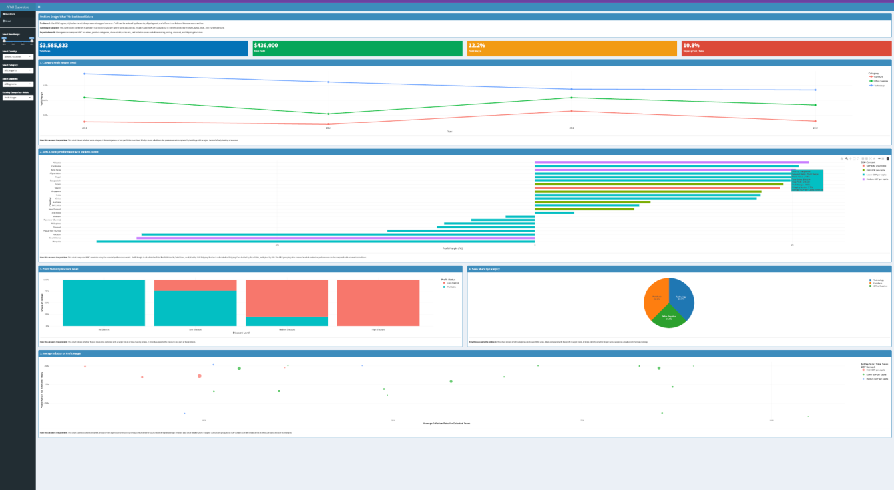

# APAC Superstore Profitability Dashboard

An interactive **R Shiny** dashboard that asks a simple question: *does high sales volume in the Asia-Pacific region actually translate into profit?*

It joins four years (2011–2014) of retail transaction data with World Bank indicators for population, inflation and GDP per capita. Managers can then see which countries, product categories and discount levels add to the bottom line and which ones drain it.



## What the dashboard shows

**Headline KPIs:** total sales, total profit, profit margin and shipping cost as a share of sales. All of them update with the filters.

| # | Chart | Question it answers |
|---|-------|---------------------|
| 1 | Category profit-margin trend (line) | Which product categories are getting more or less profitable over time? |
| 2 | Country performance with market context (bar) | How do APAC countries compare on margin, sales, profit, shipping burden or sales per million people, coloured by GDP-per-capita group? |
| 3 | Profit status by discount level (stacked bar) | At what discount level do orders start losing money? |
| 4 | Sales share by category (pie) | Where does revenue actually come from? |
| 5 | Average inflation vs profit margin (bubble) | Do countries under higher inflation pressure earn thinner margins? |

**Interactive filters:** year range, country, product category, customer segment, and the metric used for the country comparison. All charts are built with `plotly`, so they support hover, zoom and toggling legend items.

## Key findings

- **Sales ≠ profit.** Overall APAC sales were about $3.59M at a 12.2% margin, but margins vary widely, and several countries run at a loss.
- **Discounting is the clearest driver of losses.** Orders with no discount are almost all profitable. The share of loss-making orders climbs steeply at medium and high discount levels.
- **Technology is the strongest category,** with both a large share of sales and the highest margin. **Furniture** has a large sales share but the weakest margin, so it deserves closer review.
- **Inflation provides context, not causation.** The bubble chart shows how margin and inflation line up by country, but it doesn't prove that inflation reduces profit.

**Recommendation:** focus on profitable growth rather than volume. Review medium/high discount policies, look at loss-making countries for discount or shipping problems, and protect the Technology category.

## Data

| File | Source | Used for |
|------|--------|----------|
| `data/superstore.xlsx` | Global Superstore sample retail dataset | Orders, sales, profit, discount, shipping cost |
| `data/population.csv` | World Bank WDI – *Population, total* | Sales per million people |
| `data/gdp.csv` | World Bank WDI – *GDP per capita (current US$)* | Grouping countries by economic context |
| `data/cpi.csv` | World Bank WDI – *Inflation, consumer prices (annual %)* | Market-pressure comparison |

### Cleaning steps

- Filtered transactions to the **APAC** market and order years **2011–2014**
- Derived `Profit_Margin`, `Shipping_Burden`, a `Profit_Status` flag and four `Discount_Level` bands
- Reshaped the World Bank files from wide (one column per year) to long format with a reusable `clean_world_bank()` function
- Renamed countries so they match World Bank naming (e.g. *Vietnam → Viet Nam*, *South Korea → Korea, Rep.*)
- Averaged external indicators over unique country-year rows, so values aren't double-counted across transactions

**Limitations:** the transaction data only covers 2011–2014, and Taiwan isn't in the World Bank files, so it's missing from the external-data comparisons.

## Running it

Requires R (4.x) and these packages:

```r
install.packages(c("shiny", "shinydashboard", "tidyverse", "readxl",
                   "lubridate", "plotly", "scales"))
```

Then, from the project folder:

```r
shiny::runApp()
```

## Tech

R · Shiny · shinydashboard · tidyverse (dplyr, tidyr) · plotly · readxl · lubridate

---

Author: Ausaf Ayaz
